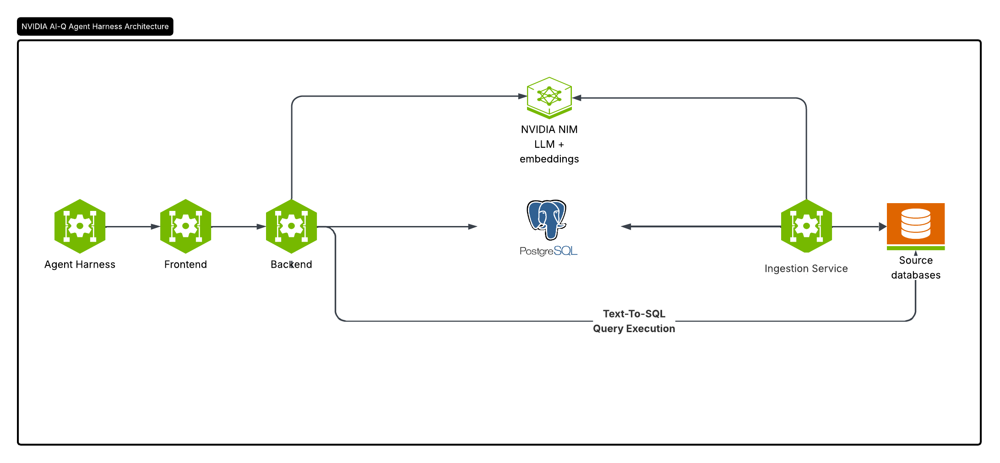

<!--
SPDX-FileCopyrightText: Copyright (c) 2026, NVIDIA CORPORATION & AFFILIATES.
All rights reserved.
SPDX-License-Identifier: Apache-2.0
-->

# alexpan 本体 —— 企业数据语义层与智能问数

本项目基于 NVIDIA 开源的 [Auto Ontology](https://github.com/NVIDIA/auto-ontology)
二次开发：从数据库元数据自动构建业务本体（语义层），让用户和 AI Agent 用自然语言问数，
并在此之上补充了**中文界面、国内模型接入、数据治理、钉钉 / 飞书问数机器人**等能力。

<p>

</p>

## 相比上游的主要改动

| 方向 | 内容 |
| --- | --- |
| 本地化 | 全中文 Web 界面，品牌为「alexpan 本体」 |
| 模型接入 | 支持任意 OpenAI 兼容接口（硅基流动、DeepSeek 等），不再强依赖 NVIDIA NIM；新增 `EMBED_DIMENSIONS` 适配向量维度 |
| 答案溯源 | 每个回答附带所用表、字段、术语与 SQL 的来源 |
| 数据治理 | 列级 / 行级访问策略、字段脱敏策略、用户组、权限申请审批、访问审计 |
| 质量闭环 | 认证问答库、答案点赞 / 点踩、「问数质量」看板（按差评、报错、无法生成查询、查无数据、权限拦截归类失败问题） |
| 术语导入 | 上传业务文档（词汇表 / 指标口径），由大模型抽取候选术语后人工确认入库 |
| PII 识别 | 自动识别敏感字段，可配合脱敏策略使用 |
| IM 机器人 | 钉钉、飞书机器人问数，支持多轮追问，按提问人账号权限执行查询 |
| 指标订阅与预警 | 按计划执行认证过的 SQL，推送到钉钉 / 飞书群；支持阈值 / 较上次变化预警、仅预警时推送、试运行 |
| 演示数据 | [`../databricks_demo/demo_shop.sql`](../databricks_demo/demo_shop.sql)：带中文注释和主外键的电商数据集 |

## 功能概览

- **自然语言问数**：问题经多阶段 Agent 流水线（候选表检索、实体解析、SQL 生成与校验、空结果修复）转为 SQL 执行，自动生成图表；支持多轮对话追问。
- **语义层 / 本体**：自动抽取表、字段、主外键、语义外键、业务术语与计算口径，存储在 Postgres（pgvector）中，可在「数据目录」「术语」页面查看和编辑。
- **数据源**：Postgres、MySQL、Snowflake、Databricks、ClickHouse、Trino、Kyuubi、DuckDB、SQLite、HeavyDB。
- **权限与认证**：基于 Better Auth 的账号体系、RBAC、SSO、API Token。
- **对外接口**：REST API、MCP Server、Agent Skills。
- **预测分析（可选）**：配置 `KUMO_RFM_API_KEY` 后启用 KumoRFM 预测查询。

## 服务组成

`docker compose` 会启动以下服务：

| 服务 | 技术栈 | 作用 | 端口 |
| --- | --- | --- | --- |
| `auto-ontology-frontend` | Next.js 16、React 19、Better Auth、Prisma | Web 界面、认证、API 网关 | 3000 |
| `auto-ontology` | FastAPI、LangChain / LangGraph | 问数、目录、数据源、治理等后端 API | 3001 |
| `ingestion-service` | FastAPI | 元数据采集、PII 识别、语义编译、生成向量 | 3002 |
| `bot-service` | Python | 钉钉 / 飞书机器人（在设置中启用前处于空闲），以及指标订阅的定时调度 | — |
| `postgres` | pgvector/pg17 | 应用数据、目录与本体、向量库 | 5432 |
| `pgadmin` | pgAdmin 4 | 数据库管理（可选） | 5050 |
| `auto-ontology-migrate` / `frontend-migrate` | Alembic / Prisma | 一次性数据库迁移任务 | — |

MCP Server 位于 [`mcp/`](./mcp/)，需单独启动（默认端口 3003）。

## 快速开始（Docker Compose）

### 1. 准备

- Docker Desktop（Windows / macOS，含 Docker Compose v2），或 Linux 上的 Docker Engine + Compose v2
- 建议内存 ≥ 16 GB、可用磁盘 ≥ 20 GB（前后端镜像都在本机构建）
- 一个 OpenAI 兼容的模型服务 API Key（下文以 [硅基流动](https://siliconflow.cn) 为例；也可用 NVIDIA API Catalog 的 `nvapi-` Key）
- 要接入的源数据库连接信息

### 2. 获取代码

```bash
git clone --config core.autocrlf=false https://github.com/alexpan0720/ontology_auto.git
```

```bash
cd ontology_auto/auto-ontology
```

> **Windows 用户务必带上 `--config core.autocrlf=false`**。容器内会执行 `prisma/migrate.sh` 等 shell 脚本，Git 默认在 Windows 上把换行转成 CRLF，会导致脚本在容器里执行失败。

### 3. 配置 `.env`

```bash
cp .env.example .env
```

`.env` 已被 `.gitignore` 忽略，里面有密码和 API Key，**不要提交，也不要直接发给别人**，每个部署方各自填写。

至少需要修改以下内容（完整变量见 [`.env.example`](./.env.example)）：

```ini
# 数据库
POSTGRES_PASSWORD=<至少 8 位>

# 认证（必填，否则所有页面都会报 Better Auth "default secret" 错误）
AUTH_SECRET=<一段足够长的随机字符串>
APP_URL=http://localhost:3000
AUTO_ONTOLOGY_ADMIN_EMAIL=admin@example.com
AUTO_ONTOLOGY_ADMIN_PASSWORD=<管理员初始密码>

# 模型（硅基流动示例）
DEFAULT_MODELS_ENDPOINT=https://api.siliconflow.cn/v1
DEFAULT_MODELS_API_KEY=<你的 Key>
DEFAULT_MODELS_MODEL=deepseek-ai/DeepSeek-V3
REASONING_MODEL=deepseek-ai/DeepSeek-V3
NON_REASONING_MODEL=deepseek-ai/DeepSeek-V3

EMBED_ENDPOINT=https://api.siliconflow.cn/v1
EMBED_API_KEY=<你的 Key>
EMBED_MODEL=Qwen/Qwen3-Embedding-8B
EMBED_DIMENSIONS=2048

RERANK_ENDPOINT=https://api.siliconflow.cn/v1/rerank
RERANK_API_KEY=<你的 Key>
RERANK_MODEL=BAAI/bge-reranker-v2-m3
```

说明：

- 每种模型角色由 `<前缀>_ENDPOINT` / `<前缀>_API_KEY` / `<前缀>_MODEL` 三个变量配置，未设置的字段回退到 `DEFAULT_MODELS_*`。

  | 前缀 | 作用 |
  | --- | --- |
  | `DEFAULT_MODELS` | 公共默认值 |
  | `REASONING` | 主模型：问数、SQL 生成 |
  | `NON_REASONING` | 轻量模型：实体抽取、术语抽取 |
  | `EMBED` | 向量模型（采集和查询必须使用同一个） |
  | `RERANK` | 重排序模型 |

- 端点不在 `nvidia.com` 域名下时，会自动走 OpenAI 兼容客户端，并用 function calling 获取结构化输出。
- pgvector 列宽固定为 **2048** 维。若向量模型原生维度不同，用 `EMBED_DIMENSIONS` 指定输出维度；更换向量模型后需重新采集。
- `POSTGRES_PORT` 只改变宿主机映射端口，容器之间始终走内部端口。

### 4. 启动

```bash
docker compose up -d --build
```

首次构建需要十几到几十分钟。数据库迁移（`auto-ontology-migrate`、`frontend-migrate`）会自动执行，可用下面的命令查看各服务状态：

```bash
docker compose ps
```

浏览器打开 <http://localhost:3000>，用 `.env` 中的管理员账号登录。后端 API 在 `:3001`，pgAdmin 在 `:5050`。

更新代码后重新部署：

```bash
git pull && docker compose up -d --build
```

> **页面异常？** 如果登录后左侧导航不显示或页面错乱，通常是 `AUTH_SECRET` 变更或数据库重置导致浏览器里残留旧会话 Cookie。清除 `localhost:3000` 的站点数据（或删除 `better-auth.session_token`）后重新登录即可。

### 5. 接入数据并生成本体

1. **设置 → 数据连接**：添加数据源。
2. 等待 ingestion-service 完成元数据采集与语义编译（**设置 → 语义编译** 可查看进度）。
3. 在 **数据目录**、**术语** 页面检查和补充语义；可在 **设置 → 术语导入** 上传业务文档批量补充术语。
4. 在 **问数** 页面直接提问。

想快速体验，可在 Databricks 中执行 [`databricks_demo/demo_shop.sql`](../databricks_demo/demo_shop.sql) 生成演示数据后接入。

### 部署到服务器供多人使用

- **只对外开放 3000 端口**。3001（后端）、3002（采集服务）、5432（Postgres）、5050（pgAdmin）不要暴露到公网：后端信任网关转发的用户身份请求头，直接暴露会被伪造身份。
- `APP_URL` 必须与用户实际访问的地址完全一致（如 `https://bi.example.com` 或 `http://服务器IP:3000`），否则登录会失败。
- 正式使用建议在前面加 Nginx 等反向代理并启用 HTTPS，并停用 pgAdmin。
- 用户由管理员在 **设置 → 用户** 中邀请，也可配置 SSO。

Kubernetes 部署见 [`DEPLOYMENT.md`](./DEPLOYMENT.md)（Helm Chart 位于 [`helm/`](./helm/)）。

## 页面导航

| 页面 | 路径 | 说明 |
| --- | --- | --- |
| 问数 | `/chat` | 自然语言问答、图表、多轮追问、答案溯源与反馈 |
| 分析 / 使用统计 | `/analysis`、`/analytics` | 分析结果与使用统计 |
| 数据目录 | `/data`、`/discovery`、`/exploration` | 表、字段、关系浏览与探索 |
| 术语 | `/terms` | 业务术语与指标口径 |
| 设置 | `/settings/*` | 按分组：**数据**（连接、数据域、标签、规则）、**语义**（语义输入、文档提取术语、语义编译）、**权限与治理**（用户、单点登录、敏感信息、数据权限、权限申请、访问审计）、**智能问数**（认证问答库、问数质量、智能体设置）、**集成**（机器人、订阅与预警、导入 / 导出） |
| 我的权限申请 | `/account/access-requests` | 查看对自己的数据限制并提交申请（右上角头像菜单） |
| API Token | `/account/api-tokens` | 生成脚本调用用的 Token |

## 数据治理

在 **设置 → 数据权限** 中按用户组配置策略，管理员不受策略限制：

- **列策略**：禁止读取指定字段。SQL 中任何位置引用该字段（含 `SELECT *`）都会被拒绝。
- **行策略**：把对表的引用改写为按谓词过滤后的子查询，只返回用户有权看到的行。
- **脱敏策略**：被脱敏字段在所有用法中（查询列、分组、过滤、关联）都只能看到脱敏后的值。

策略在数据库连接器层面统一强制执行，问数主查询、取值探测、空结果修复等所有 SQL 都会经过检查；无法确定安全的 SQL（解析失败、多语句等）一律拒绝。所有查询记录在 **设置 → 访问审计**。

用户可在被拦截时发起**权限申请**：问数回答被拦截时下方会出现「申请访问」按钮，也可在头像菜单 →「我的权限申请」中提交。管理员在 **设置 → 权限申请** 审批后，申请人会被加入策略放行的用户组（默认使用该策略专属的「授权」组，不影响其他人），下一次提问即生效。

## 钉钉 / 飞书机器人

1. 在钉钉或飞书开放平台创建企业内部应用并开启机器人能力，获取 App ID / App Secret。
2. 在 **设置 → 机器人** 填写并启用。`bot-service` 通过 Stream / 长连接主动连接平台，**无需公网地址**。
3. 在群聊中 @机器人 或私聊提问。可以接着追问（如「那华东呢？」），机器人会回复「理解为：…」；发送「新问题」重新开始。上下文按「群 + 提问人」区分，最多保留 3 轮，30 分钟无提问自动清空。

机器人本身不直接查库，而是以「发送人邮箱对应的账号」调用与 Web 端相同的问数接口，访问策略、脱敏和审计全部生效；找不到对应账号时按「不属于任何用户组」的最严格权限执行。

## 指标订阅与预警

1. 在钉钉群或飞书群添加「自定义机器人」（建议开启加签），在 **设置 → 订阅与预警 → 推送渠道** 中填入 Webhook 和密钥，可发送测试消息。
2. 新建订阅：从认证问答库选择口径（或填写只读 SQL），设置频率（工作日 / 每天 / 每周 / 每小时）和推送渠道。
3. 可选预警：数值高于 / 低于阈值，或较上次运行变化超过一定百分比；多行结果逐行判断。可设为「只在触发预警时推送」。

订阅默认按「不属于任何用户组的普通用户」的权限查询，群里的人都只能看到脱敏后的数据；所有订阅查询都记入访问审计。定时调度由 `bot-service` 负责，未运行时可在界面上「立即推送」。

## 问数质量

**设置 → 问数质量** 汇总网页端和机器人里没答好的问题，同一问题的不同问法会合并，按出现次数排序。可直接「补充认证问答」（之后相似问题会参考这条 SQL），或「标记已处理」（再次失败时重新出现）。

## 连接凭据存储

数据源有两种来源：

1. **在界面中添加**：未配置 Vault 时，连接信息（含密码）以**明文 JSON** 存在 Postgres 中；配置了 Vault（`VAULT_ADDR`、`VAULT_NAMESPACE`、`VAULT_ROLE_ID`、`VAULT_SECRET_ID` 全部设置）时凭据写入 Vault，数据库中不保存凭据。
2. **环境变量 `CONNECTION_STRINGS`**：逗号分隔的连接串，仅在界面中没有任何连接时使用。

机器人的 AppSecret 和推送渠道的 Webhook / 加签密钥同样以明文存在 Postgres 中（接口不会返回它们），请限制数据库的访问权限。

## 认证与 API

### SSO

支持 SSO 登录，在身份提供方中配置回调地址：`<APP_URL>/api/auth/sso/callback`。

### API Token

脚本、Notebook、定时任务请使用 API Token：右上角用户菜单 → **API Tokens** → **New token**。Token 只显示一次（服务端仅保存 SHA-256 哈希）。

```sh
curl -H "x-api-key: $AUTO_ONTOLOGY_API_TOKEN" http://localhost:3000/api/terms
```

```python
import os
import requests

session = requests.Session()
session.headers["x-api-key"] = os.environ["AUTO_ONTOLOGY_API_TOKEN"]

terms = session.get("http://localhost:3000/api/terms").json()
answer = session.post(
    "http://localhost:3000/api/chat/completions",
    json={"question": "上周发货了多少订单？"},
)
```

- Token 以所有者身份执行，权限与该用户在浏览器中完全一致（包括数据治理策略）。
- 也可用 `Authorization: Bearer <token>`。
- 删除 Token 或禁用用户后立即失效；Token 不能用来创建或吊销 Token。
- 完整接口定义见 [`docs/openapi/auto-ontology-api.json`](./docs/openapi/auto-ontology-api.json)。

### 问数接口与多轮对话

`POST /api/chat/completions` 返回 SSE 流，事件类型为 `step`、`result`、`error`，以 `[DONE]` 结束。

- 不传 `conversation_id`：单次无状态请求。
- 传入客户端生成的 UUID：创建或延续一个会话，后续轮次复用同一个 UUID；必须等上一轮 `[DONE]` 后再发下一轮，否则返回 `409`。

```json
{
  "question": "那上个月呢？",
  "conversation_id": "d61d8aa3-d496-4fa7-97ce-4f831c162e7f"
}
```

后端会读取最近 5 轮（不超过 12,000 字符）已完成的对话，把「那上个月呢？」这类追问改写为独立问题后再执行。通过 API 创建的会话可在界面中用 `/chat?focus=<conversation_id>` 打开。

> **安全提示**：FastAPI 端口（3001）是内部服务边界，信任网关转发的 `x-auto-ontology-user-id` 请求头，**不要暴露到公网**。外部调用请一律走 Next.js 网关（3000）。

## MCP 与 Agent Skills

- **MCP Server**：Cursor、Claude Desktop 等可通过 MCP 查询数据，见 [`mcp/`](./mcp/) 和 [`docs/mcp.md`](./docs/mcp.md)。
- **Agent Skills**：位于 [`skills/`](./skills/)（`nvidia-ontology-setup`、`nvidia-ontology-management`、`nvidia-ontology-query`）。编码 Agent 入口见 [`AGENTS.md`](./AGENTS.md)。

## 开发

| 目录 | 内容 |
| --- | --- |
| `auto_ontology/` | Python 后端：`server/`（API）、`retrieval/`（问数流水线）、`semantic/`（语义编译）、`catalog/`（元数据）、`connectors/`、`governance/`、`bots/`、`subscriptions/` 等 |
| `frontend/` | Next.js 前端，见 [`frontend/README.md`](./frontend/README.md) |
| `alembic/` | 后端数据库迁移（`public` schema）；前端表由 Prisma 管理（`frontend` schema） |
| `dev_tools/` | 本地采集、测试数据、OpenAPI 生成等脚本，见 [`dev_tools/README.md`](./dev_tools/README.md) |
| `helm/` | Kubernetes Helm Chart |

本机有 `uv` 时可直接启动后端（热重载）并运行检查：

```bash
uv run uvicorn auto_ontology.server.__main__:create_app --factory --reload --host 127.0.0.1 --port 3001
```

```bash
uv run ruff check auto_ontology/ && uv run pytest auto_ontology dev_tools -q
```

修改任何路由的签名或 docstring 后，需运行 `uv run python -m dev_tools.generate_backend_openapi` 更新 `docs/openapi/*.json`。

没有 `uv` 时，也可以在后端镜像内跑测试：

```bash
docker compose run --rm --entrypoint sh auto-ontology -c "python -m pytest auto_ontology -q"
```

（镜像默认不含 pytest，需要先在容器内安装。）

## 外部依赖与免责声明

运行时会与以下外部服务交互，请自行遵守其条款：

| 对象 | 何时 |
| --- | --- |
| 你配置的模型服务（`*_ENDPOINT`，如硅基流动、NVIDIA API Catalog） | 问数、采集、语义编译 |
| 钉钉 / 飞书开放平台 | 启用机器人或推送时 |
| KumoRFM | 仅设置 `KUMO_RFM_API_KEY` 时 |
| 你的源数据库 | 采集、数据剖析、执行查询 |

本软件按「原样」提供，不附带任何担保。

## 许可证

基于 [Apache License 2.0](./LICENSE) 发布，原始代码版权归 NVIDIA CORPORATION & AFFILIATES 所有。
第三方组件见 [`THIRD_PARTY_NOTICES.md`](./THIRD_PARTY_NOTICES.md) 与
[`CONTAINER_THIRD_PARTY_NOTICES.md`](./CONTAINER_THIRD_PARTY_NOTICES.md)。
